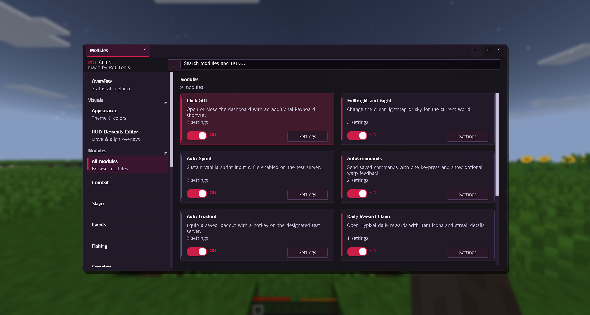
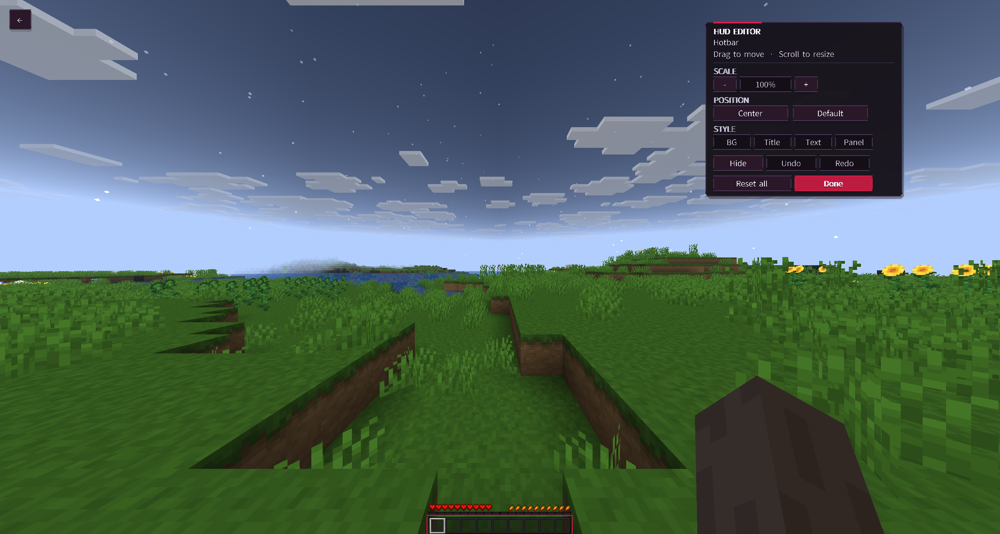
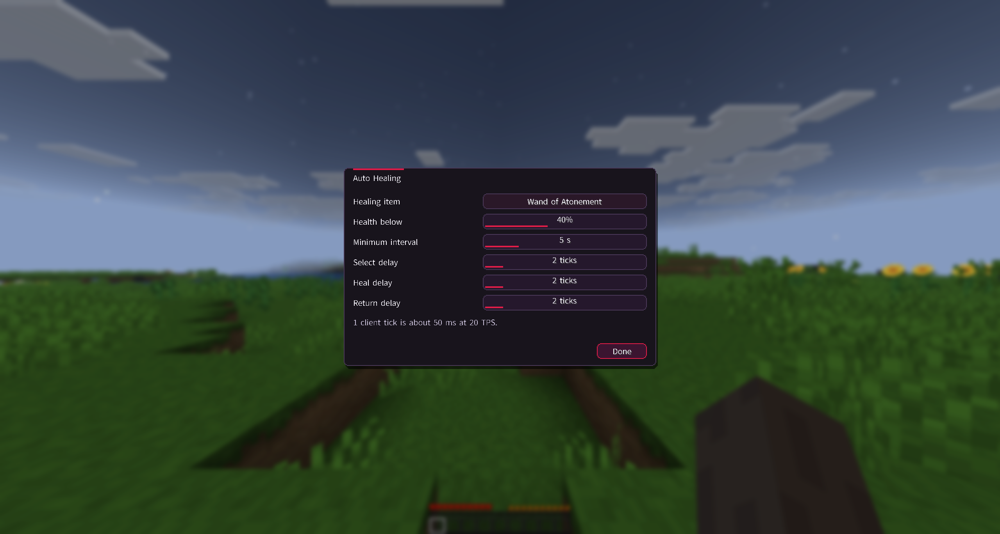

# Rot Client for Minecraft 26.2

Made by **Rot Tools**. Current development starts with **Rot Client Illegal dev.21**, rebuilding features individually on the existing dashboard and HUD foundation.

**[Download Illegal dev.21](https://github.com/rot-tools/Rot-Client/releases/download/playtest-26.2-rebuild-dev.21/RotClientIllegal-0.1.0-dev.21%2Bmc26.2.jar)** · [All four editions](https://github.com/rot-tools/Rot-Client/releases/tag/playtest-26.2-rebuild-dev.21) · [Checksums](https://github.com/rot-tools/Rot-Client/releases/download/playtest-26.2-rebuild-dev.21/SHA256SUMS.txt)

| Edition | Download | Role |
| --- | --- | --- |
| **Rot Client Illegal dev.21** | [Download JAR](https://github.com/rot-tools/Rot-Client/releases/download/playtest-26.2-rebuild-dev.21/RotClientIllegal-0.1.0-dev.21%2Bmc26.2.jar) | Primary Minecraft 26.2 development and test edition, maintained by the project owner. |
| **Rot Client Legal dev.21** | [Download JAR](https://github.com/rot-tools/Rot-Client/releases/download/playtest-26.2-rebuild-dev.21/RotClientLegal-0.1.0-dev.21%2Bmc26.2.jar) | Shared dashboard and HUD foundation, developed by the collaborator. |
| Rot Client+ 2.0.11 | [Reference JAR](https://github.com/rot-tools/Rot-Client/releases/download/playtest-26.2-rebuild-dev.21/RotClientPlus-2.0.11%2Bmc26.2.jar) | Previous full client, preserved as a feature and source reference. |
| Rot Client Lite 2.0.11 | [Reference JAR](https://github.com/rot-tools/Rot-Client/releases/download/playtest-26.2-rebuild-dev.21/RotClient-2.0.11%2Bmc26.2.jar) | Previous HUD/QoL edition, preserved as a reference. |

## Screenshots

Actual Illegal dev.21 screens captured in a local Minecraft world.

| HUD layout editor | Auto Healing settings |
| --- | --- |
|  |  |

## Features in the current Illegal build

| Module | What it does |
| --- | --- |
| Click GUI | Assign an optional keyboard shortcut to open or close the dashboard. The dashboard also opens with `/rot` or `/rotclient`. |
| Fullbright and Night | Adjust the client lightmap for brighter visibility, use a night sky, and choose whether both effects can run together. |
| Auto Sprint | Sustain vanilla sprint input while enabled. Includes a separate toggle key. |
| AutoCommands | Create, edit and remove command shortcuts. Browse 48 documented warp destinations and aliases. Show warp success or failure feedback with editable colors, opacity, background, duration, scale and position. |
| Auto Loadout | Assign keys to 12 saved loadouts. Configure equip and close delays from 1–8 ticks and maximum delay variety from 1–5 ticks. The menu closes after the switch and aborts when its context changes. |
| Auto Clicker | Independent left/right lanes, keyboard or mouse hold bindings, 5–20 CPS, CPS jitter, block-breaking behavior, Dungeon Breaker guard, item whitelists and Terminator mode. Short mouse taps pass through normally. Repetition starts after a continuous hold of about 180 ms. |
| Daily Reward Claim | Open the daily reward picker from the reward link/book. Show reward icons, titles, rarity, Streak and Best. Select and claim a reward when supported by the reward page. Browser fallback remains available. |
| Legacy SkyBlock Textures | Restore mapped classic item models and manage compatible resource packs. Includes the three Rot dark packs and MSC Black Glass with independent color choices for blocks and panes. The public JAR reads `MSC-Black-Glass-26.2.zip` from the instance's `resourcepacks` folder. |
| Auto Healing | Detect the configured healing item in any of the nine hotbar slots. Use fresh SkyBlock HP/max-HP to check a 1–100% threshold. Separate 1–10 tick sliders control selection, use and return, with a 1–20 second minimum interval and observed item cooldown. Manual hotbar changes cancel the sequence. Missing items keep it idle and reinsertion resumes detection. |

### Dashboard and HUD

Search module names, settings and supported HUD elements from the dashboard. Categories remain available for future modules. The rebuild currently contains the nine modules listed above.

The shared HUD editor supports hiding, moving and scaling 14 vanilla layers. Select a visible element, drag to move, scroll to resize and use Default to restore its vanilla position and scale. Undo, redo and resets are available. Hide Status Effects applies to the gameplay HUD and the vanilla inventory.

Supported layers are Hotbar, Health Hearts, Hunger, Armor Icons, XP Bar / Level, Air Bubbles, Mount Health, Scoreboard, Boss Bar, Action Bar, Held Item Name, Status Effects, Titles and Player Tab List.

## Install

1. Use **Minecraft 26.2**, **Java 25**, **Fabric Loader 0.19.3+** and **Fabric API for 26.2**.
2. Download one edition from the release and place it in the instance's `minecraft/mods` folder.
3. Enable one Rot edition at a time. Preserve your configuration when upgrading.
4. Open the dashboard with **`/rot`** or **`/rotclient`**. An additional key can be enabled through **Interface → Click GUI**.
5. For MSC Black Glass, keep the original `MSC-Black-Glass-26.2.zip` in `minecraft/resourcepacks`.

New module settings default to off. Your saved choices persist. Illegal is the test-server edition. Legal is the future public HUD/QoL edition and still needs its own gameplay and publication review.

## Current validation

The Java 25 build passes **38 tests** and `verifyEditions`. Illegal and Legal are built from the same shared UI foundation, with Illegal implementation classes excluded from Legal.

The owner has reported working Auto Loadout, Daily Reward Claim, Auto Clicker, per-color Black Glass and dev.20 Auto Healing timing. Dev.21 adds the missing-item guard, immediate pre-use cancellation on item removal, the `/rotclient` alias and removal of the unconditional Right Shift shortcut. Those latest changes require the next dedicated playtest. Screenshots demonstrate UI appearance and navigation.

## Development and responsibilities

- **Owner** develops and playtests **Illegal**.
- **Collaborator** develops and playtests **Legal**.
- Shared dashboard and HUD improvements belong to both editions.
- Review each candidate feature for Legal and test it there separately before accepting it.
- Use `development` as the integration branch and a `codex/` feature branch for individual changes. Fetch before integrating collaborator work. `main` holds tested stable releases.

Open **`rebuild-26.2/` in VS Code**. Run `gradlew.bat build` from that directory with Java 25. The root Gradle project builds the previous Plus/Lite line.

[Source/build guide](rebuild-26.2/README.md) · [Team handoff](rebuild-26.2/TEAM_HANDOFF.md) · [Current project state](docs/PROJECT_STATE.md) · [Roadmap](docs/REBUILD_ROADMAP.md) · [Previous Plus/Lite documentation](docs/archive/PLUS_LITE_README.md)

## Credits

Rot Tools maintains the project. The UI font retains its OFL notice, AutoCommands retains its MIT notice, and resource packs retain their attribution. [License](LICENSE) · [Third-party notices](THIRD_PARTY.md)
